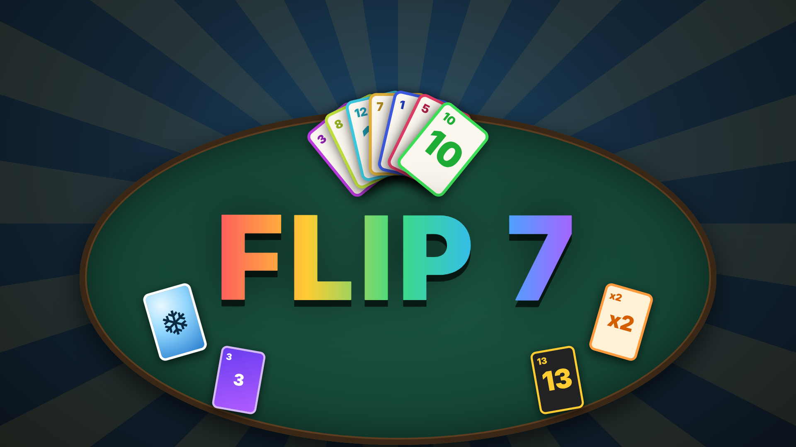
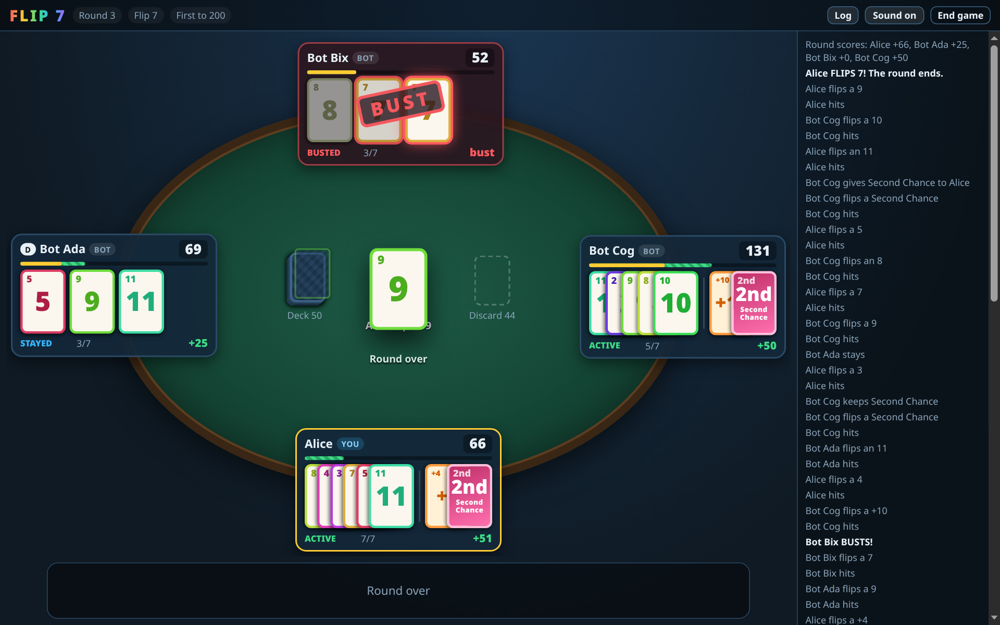
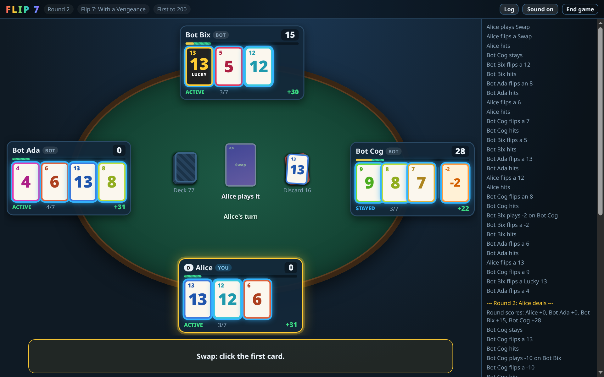
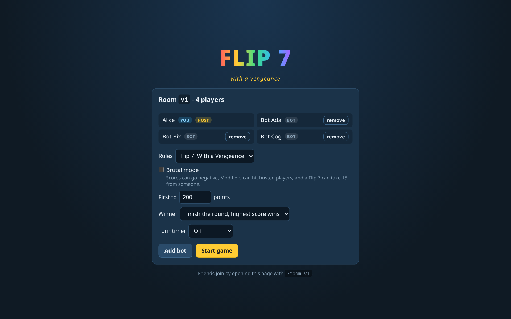
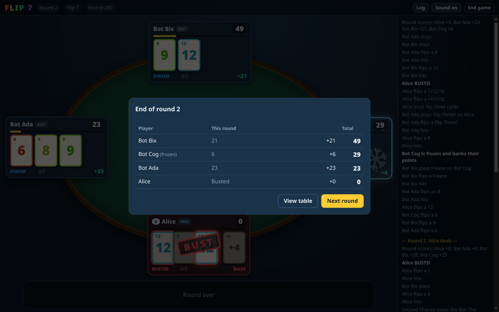
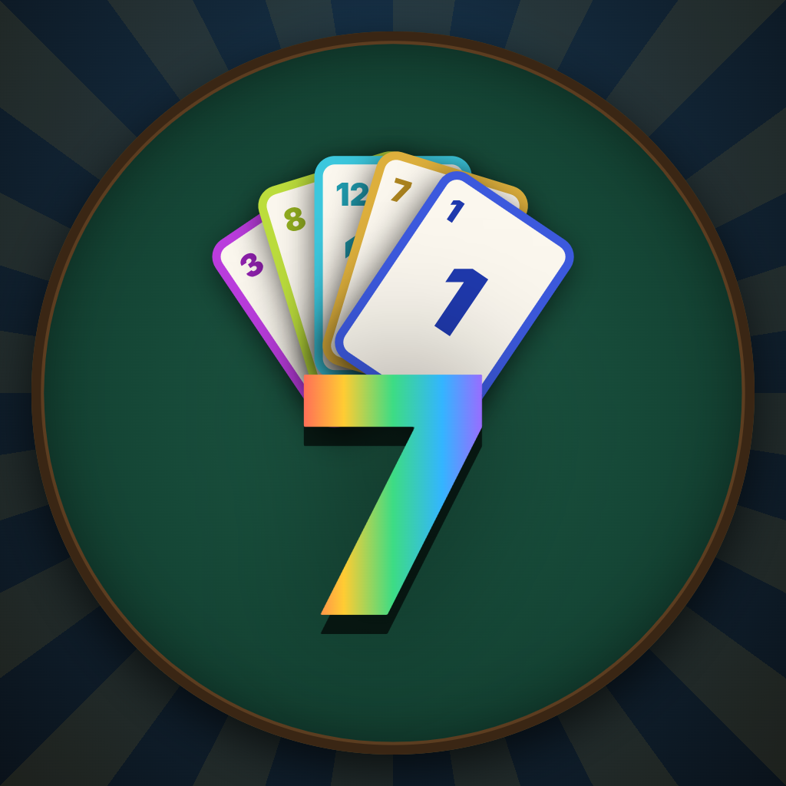

# Flip 7 - Discord Activity



Unofficial fan implementation of *Flip 7* (default, ruleset 3.1) and *Flip 7: With a Vengeance* (The Op / USAopoly), selectable in the lobby.

> Not affiliated with or endorsed by The Op. *Flip 7* is a trademark of its
> owners; buy the real game, it's great.

Official rulebooks (PDF):
- [Flip 7](https://cdn.shopify.com/s/files/1/0611/3958/3198/files/25_FLIP_7_TB_RULES_C_Rev_9_2_25_ND.pdf?v=1756935535)
- [Flip 7: With a Vengeance](https://cdn.shopify.com/s/files/1/0611/3958/3198/files/26_FLIP_7_VENGEANCE_RULES_C.pdf?v=1770853609)

## Screenshots

| | |
|---|---|
|  |  |
| **Flip 7**: seven unique Numbers end the round | **With a Vengeance**: Lucky 13, negative Modifiers, Swap |
|  |  |
| **Lobby**: rules, target score, win rule, turn timer, bots | **End of round** scores |

### Art

Discord activity art lives in `art/`: [`cover.png`](art/cover.png) and
[`background.png`](art/background.png) (1920x1080) and
[`icon.png`](art/icon.png) (1024x1024). They are rendered from
`art/art.html` (`?m=cover|bg|icon`) with `art/shoot.mjs`, which screenshots
the active tab of a Chrome running with `--remote-debugging-port=9222`:

```bash
node art/shoot.mjs art/cover.png 1920 1080 1 "file://$PWD/art/art.html?m=cover"
```



## Quick start

```bash
npm install
npm run dev        # server :3001 (dev mode) + Vite client :5173
```

Then open one of:

| URL | What |
|---|---|
| http://localhost:5173/dev.html | **Test harness**: 3 players side by side in one tab (`?players=1..6&room=x`) |
| http://localhost:5173/?room=test | Single player view. Open more tabs/browsers with the same `room` to add players |
| http://localhost:5173/?room=test&name=Bob&pid=bob | Fixed identity (handy for multiple tabs in the same browser) |

In the lobby, the host can **Add bot** to fill seats, so you can play solo.
Friends on your LAN/Tailscale can join via `http://<your-ip>:5173/?room=test`.

### Dev-mode tools
- **DEV next card** (top bar): put any card on top of the deck to test
  specific situations (Unlucky 7, Swap, Flip Four...).
- `BOT_DELAY_MS=300 npm run dev` speeds bots up.

### Connections and timers
- The server pings every socket every 20s and the client pings the server
  every 15s, so idle lobbies survive Discord/cloudflared idle timeouts.
- A player who drops keeps their lobby seat for `LOBBY_GRACE_MS` (45s) and
  the host keeps host status for `HOST_GRACE_MS` (30s).
- Removed players can **Sit down** again from the lobby.
- Optional turn timer (lobby): when it runs out you stay (or hit, if you
  can't stay). Target choices (give/steal/swap...) are made by the bot.
  The timer starts once the card animations have finished.
- Only the host starts the next round.
- While waiting for your turn you can queue Hit or Stay. When your turn
  comes it fires after 1.5s; click the queued button again to cancel.
- Winner rule (lobby): *finish the round, highest score wins* (official), or
  *first to bank the target wins instantly* (on stay, Freeze or Flip 7).
- Sound effects are synthesised with Web Audio; toggle them with
  **Sound on/off** in the top bar (remembered per browser).
- **End game** asks for confirmation inline (`window.confirm()` is blocked
  inside the Discord activity iframe, which is why it used to do nothing).

### Tests

```bash
npm test           # rules engine: every special card, FAQ rulings, 40 bot-only games
npm run typecheck
```

### Production-style run

```bash
npm run build && npm start     # one port (3001) serves client + websocket
```

### Guests vs Discord login
Browser players (no Discord) are *guests*: their id and name come from the
URL/localStorage, so they are not verified. Guests are allowed in dev mode or
when Discord credentials are not set. Once `.env` has Discord credentials,
the server requires a verified Discord login for every player, so strangers
who find your tunnel URL can't join or pose as someone else. Set
`ALLOW_GUESTS=1` to allow guests anyway.

## Layout

```
src/shared/cards.ts     deck composition (DECK_COUNTS), card helpers
src/shared/rules.ts     rule switches, presets and custom-rule validation
src/shared/scoring.ts   bust / Flip 7 / score calculation
src/shared/engine.ts    server-authoritative rules engine (task queue + prompts)
src/shared/bot.ts       heuristic bot (also plays for disconnected players after 15s)
src/server/index.ts     HTTP + WebSocket rooms
src/client/             React UI; identity.ts is where the Discord SDK will plug in
dev.html                multi-player test harness
```

## Rules decisions

### Flip 7 (classic, default)
From the [ruleset 3.1 rulebook](https://cdn.shopify.com/s/files/1/0611/3958/3198/files/25_FLIP_7_TB_RULES_C_Rev_9_2_25_ND.pdf?v=1756935535) (94 cards: 0-12, +2..+10, x2, 3x Freeze,
3x Flip Three, 3x Second Chance):
- Modifiers stay with whoever drew them; x2 doubles the Number sum, then
  +N Modifiers are added (they score even without Number cards).
- Action cards target any active player (not busted, not stayed); if you are
  the only one, you must play it on yourself.
- Second Chance is kept; if you already have one, give it to another active
  player without one, otherwise discard it. It cancels one bust (both cards
  are discarded) and is discarded at the end of the round.
- Flip Three: stop on a bust/Flip 7; a Second Chance is used immediately,
  Freeze/Flip Three are resolved afterwards (discarded if the player busted).
- You may only stay with at least one card in front of you.

### Flip 7: With a Vengeance
From the [rulebook](https://cdn.shopify.com/s/files/1/0611/3958/3198/files/26_FLIP_7_VENGEANCE_RULES_C.pdf?v=1770853609) plus the official FAQ (theop.games/pages/flip-7-wav-faqs):
- Action/Modifier cards are given to any non-busted player (including stayed
  players); the receiver must use an Action if any valid target exists,
  otherwise it is discarded.
- House rule: Steal, Swap and Discard are always used by whoever drew them
  (no player to pick first), which saves a prompt every time.
- Swap and Steal can bust players (both at once with a Swap).
- Unlucky 7 discards everything else, even an existing 7, and also triggers
  when gained by Steal/Swap. Lucky 13 allows exactly one other 13.
- Flip Four: stop on a bust/Flip 7; Actions/Modifiers flipped are resolved in
  order afterwards; a bust discards them. A target who had stayed remains stayed.
- Just One More: take one card (resolve it if it's an Action), then stay.
- Holding the Zero: you can't choose to stay.
- Brutal mode: negative round scores, Modifiers may hit busted players,
  Flip 7 may take 15 from another player instead of +15.

### Custom rules
Pick **Custom rules** in the lobby to edit the deck and the rule switches
(`src/shared/rules.ts`). Start from either official preset, then:
- Set how many of each card are in the deck (0-30 each): Numbers 0-13, the
  Zero / Unlucky 7 / Lucky 13, both Modifier families and all eight Actions,
  mixed freely. At least 10 Number cards are required.
- **Give Modifiers**: drawn Modifiers are given to a player (Vengeance) instead
  of kept (classic).
- **Target stayed players**: Actions and Modifiers may go to stayed players.
- **Need a card to stay**: classic rule; the Zero always prevents staying.
- **Self-played Steal/Swap/Discard**: the house rule above; off = the drawer
  picks who uses them.
- Flip 7 length (3-15 unique Numbers) and bonus (0-100), plus Brutal mode.

If nobody can draw (tiny deck, all cards on the table), a player who must hit
is made to stay instead.

## Running it in Discord

How it works: Discord loads the activity in an iframe through its proxy
(`<client-id>.discordsays.com`), which forwards to the URL mapped to `/`.
The server serves the client, `/ws` and `/api/token` on one port, so one
mapping is enough. Inside Discord, players are their Discord accounts
(verified server-side) and the room is the activity instance.

### One-time setup
1. https://discord.com/developers/applications -> **New Application**.
   (Friends need to be on a [developer team](https://discord.com/developers/teams)
   that owns the app to launch it; see below.)
2. **OAuth2**: copy Client ID and Client Secret into `.env`
   (`cp .env.example .env`). Add redirect `https://127.0.0.1` (placeholder).
3. **Installation**: enable User Install and Guild Install.
4. **Activities -> Settings**: tick **Enable Activities**.
5. `sudo pacman -S cloudflared`

### Each session
```bash
npm run discord     # builds client, serves everything on :3001
npm run tunnel      # prints https://<random>.trycloudflare.com
```
Then **Activities -> URL Mappings**: set `/` -> `<random>.trycloudflare.com`
(no `https://`). Quick tunnels get a new URL each run, so update the mapping
each time (or set up a named cloudflared tunnel for a fixed hostname).

Join a voice channel, open the App Launcher (rocket icon), pick the app.

### Debugging
Easiest: run Discord in a browser (discord.com/app) and use the browser's
DevTools (F12). The desktop PTB client also has View -> Developer -> Toggle
Developer Tools.
